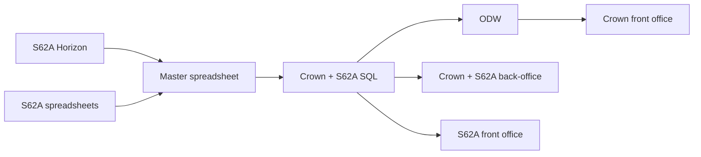
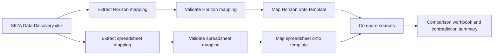

# S62A Migration Technical Documentation

## 1. Purpose

The `S62aMigration` process migrates S62A case data from two source systems into the legacy S62A master template:

- Horizon extracts
- The legacy spreadsheet data source

The process is driven by the S62A Data Discovery workbook, which records the relationship between master-template fields and source-system fields. It produces mapped template workbooks, audit reports, unmapped-column reports, and a final comparison workbook that identifies disagreements between Horizon and spreadsheet values.

## 2. Phase 3 Migration Context

Phase 3 migrates S62A cases from Horizon and the existing S62A spreadsheets into the ODW SQL data store. The migration scripts in this document provide the preparation and reconciliation step for that flow: the two source datasets are mapped into a common legacy master-template structure, combined by case reference, and checked for conflicting populated values before the data is loaded into SQL.

**Confluence diagram placement:** Insert the supplied **“TO-BE OPTION 2 (PREFERRED)”** architecture diagram here. It shows Horizon and S62A spreadsheets feeding the master spreadsheet, with the resulting S62A data then progressing through the Crown/ODW pipeline into the SQL-backed ODW platform and downstream Crown services.

The diagram’s relevant S62A migration path can be summarized as:



For this repository, the master spreadsheet is produced by the Horizon and spreadsheet mapping scripts. `compare_sources.py` then provides the reconciliation output used to identify differences before the agreed master data is migrated into the Phase 3 SQL target.

## 3. Scope and Repository Location

All migration-specific assets are located under:

`odw-synapse-workspace/S62aMigration/`

The process has three logical stages:

1. Extract and validate the field mappings.
2. Map each source system (horizon and spreadsheet) onto the master template.
3. Compare the two mapped outputs and report contradictions.



## 4. Folder Structure

### 4.1 `csv_and_xlsx_files/`

This directory contains the source files and the mapping authority.

| Location | Purpose |
|---|---|
| `MASTER LEGACY cases S62A .xlsx` | Authoritative legacy template. Its `Template` sheet defines the master field names, order, formatting, merged headings, and header row. |
| `S62A Data Discovery.xlsx` | Data Discovery workbook containing the field, source-system, and source-field relationships. |
| `Horizon_extracts/` | Horizon CSV extracts used by the Horizon validation and mapping scripts. |
| `SS_data/` | Spreadsheet source workbooks used by the spreadsheet validation and mapping scripts. |

The Data Discovery sheet used by the extraction scripts is:

`S62A Data Discovery.xlsx` -> `BO Crown Comparison - USE THIS`

The relevant discovery columns are located by header name rather than fixed Excel column letters:

- `Field`: master-template field name.
- `Source`: source system, for example `Horizon`, `Spreadsheet`, or `Horizon/Spreadsheet`.
- `Source field (Horizon / Spreadsheet)`: source-system field name or names.

When a discovery row contains both systems, source fields separated by `/` are matched to the systems in the same order. For example, the Horizon field is selected from the Horizon position and the spreadsheet field from the Spreadsheet position.

### 4.2 `master_spreadsheet_scripts/`

The scripts are separated by source system:

```text
master_spreadsheet_scripts/
├── horizon/
│   ├── extract_horizon_field_mapping.py
│   ├── validate_horizon_field_mapping.py
│   └── map_horizon_onto_template.py
├── spreadsheet/
│   ├── extract_ss_field_mapping.py
│   ├── validate_ss_field_mapping.py
│   ├── map_ss_onto_template.py
│   └── ssmapping_stepbystep.py
└── flag_differences/
    └── compare_sources.py
```

Each source pipeline has three principal activities:

1. Extract the source-specific mapping from the Data Discovery workbook.
2. Validate that mapped source fields exist in the actual source files.
3. Map source values into the legacy master template.

`ssmapping_stepbystep.py` is an older interactive/block-by-block spreadsheet mapping implementation. `map_ss_onto_template.py` is the consolidated spreadsheet mapping script intended for the configured multi-sheet workflow.

### 4.3 `master_spreadsheet_scripts/spreadsheet/`

This folder prepares the existing spreadsheet source data for comparison with Horizon.

| Script | Summary |
|---|---|
| `extract_ss_field_mapping.py` | Reads the Data Discovery workbook and creates the spreadsheet-specific field mapping CSV. It identifies which legacy-template fields should come from the spreadsheet source and records the corresponding spreadsheet column names. |
| `validate_ss_field_mapping.py` | Checks that the spreadsheet source fields in the mapping can be found in the configured spreadsheet worksheets. It produces a validation report and applies the source aliases or known corrections needed by the spreadsheet mapper. |
| `map_ss_onto_template.py` | Reads the spreadsheet source workbooks and the spreadsheet mapping CSV, transforms the values where required, and writes them into the legacy master template. It also creates spreadsheet audit and unmapped-column reports. |
| `ssmapping_stepbystep.py` | An older, interactive version of the spreadsheet mapping process. It is useful for investigation and step-by-step debugging, but is not normally part of the standard automated run. |

### 4.4 `master_spreadsheet_scripts/horizon/`

This folder performs the equivalent preparation for Horizon CSV extracts.

| Script | Summary |
|---|---|
| `extract_horizon_field_mapping.py` | Reads the Data Discovery workbook and creates the Horizon-specific field mapping CSV. The mapping uses the Horizon source-field definition for each legacy-template field. |
| `validate_horizon_field_mapping.py` | Checks that each mapped Horizon source field exists in the correct Horizon extract. `Source field` values include both a filename token and column name, such as `basic_data.CaseReference`; the validator matches the exact extract token within dated Horizon filenames before checking the column. |
| `map_horizon_onto_template.py` | Reads all mapped Horizon extracts and writes their data into the legacy master template. It joins `CaseUniqueId`-only extracts, such as `extended_data`, to `CaseReference` using the case-reference list; applies conditions; handles repeated values; removes template-only example rows; and produces Horizon audit and unmapped-column reports. |

For the Horizon mapper, extract matching is exact at the filename-token level. For example, `case_involvement` must match the base `case_involvement` extract and must not accidentally match `case_involvement_p` or `case_involvement_o`.

### 4.5 `master_spreadsheet_scripts/flag_differences/`

| Script | Summary |
|---|---|
| `compare_sources.py` | Reads the Horizon-populated template and spreadsheet-populated template, aligns them by `Case reference`, and creates a side-by-side comparison workbook. It highlights populated values that differ, includes a contradiction summary, supports spreadsheet-only fields, and keeps fields sourced only from `extended_data` on the Horizon side. |

The comparison workbook is the review point for business users. It is manually colour-coded to show which source should be taken forward for each field.

### 4.6 `master_spreadsheet_scripts/final_spreadsheet/`

| Script | Summary |
|---|---|
| `extract_final_cols.py` | Reads the manually colour-coded comparison workbook and creates a `Final selected` sheet. It uses green selections to choose the preferred source, uses a light-green paired source only as a per-case fallback when the preferred value is blank, excludes `White, Background 1, Darker 15%` columns, and retains other coloured source columns for later review. It preserves the original side-by-side `Template` comparison sheet and carries forward relevant formatting and Row 1 group headings. |

#### `extract_final_cols.py` technical summary

**Purpose:** Convert the manually reviewed comparison workbook into a final, source-selected spreadsheet while preserving the original comparison tab for audit and further review.

**Inputs:**

- `csv_and_xlsx_files/S62A_Horizon_vs_Spreadsheet_comparison_coloured_sheet.xlsx`
- `csv_and_xlsx_files/MASTER LEGACY cases S62A .xlsx`

The comparison workbook is read from the `Template` sheet. Its source headers and review colours are expected on Row 3, with case data beginning on Row 4. The legacy template supplies the final field layout and standard formatting.

**Output:**

- `outputs/MASTER LEGACY cases S62A - final.xlsx`

The output preserves the original comparison `Template` sheet and adds a `Final selected` sheet containing the selected values.

**Selection rules:**

1. Source columns are grouped by their common field name, for example `Application phase (horizon)` and `Application phase (spreadsheet)`.
2. A `Green` header is treated as the preferred source for that field.
3. If the preferred Green value is blank for a case, the paired source is used only when its header is `light green`.
4. Columns filled `White, Background 1, Darker 15%` are treated as excluded grey columns and are not copied.
5. If no Green source exists, every remaining non-grey source column is retained separately with its original `(horizon)` or `(spreadsheet)` suffix. This allows fields with unresolved colour decisions to remain available for later review.
6. For Green-selected fields, the source suffix is removed from the final header. For example, the selected source columns become `Application phase` rather than `Application phase (horizon)` or `Application phase (spreadsheet)`.

**Case handling:**

- Cases are grouped by `Case reference`.
- Multiple comparison rows for the same case are considered together.
- The first non-blank value from the selected primary source is used.
- The light-green fallback is checked only when the primary value is blank.

**Formatting and presentation:**

- Row 1 group labels are copied from the comparison sheet.
- Repeated contiguous Row 1 labels are merged and centred.
- Selected source header styles, fills, fonts, borders, number formats, and alignment are retained where applicable.
- The original side-by-side comparison remains unchanged in the output workbook.

**Colour implementation:**

The script recognises RGB, indexed, and Excel theme/tint fill representations. This is important because `White, Background 1, Darker 15%` may be stored as a theme colour rather than a simple RGB value.

**Execution:**

```bash
/Users/nisalihalwathura/PINS/ODW-Service/odw-azure-functions/.venv/bin/python \\
  odw-synapse-workspace/S62aMigration/master_spreadsheet_scripts/final_spreadsheet/extract_final_cols.py
```

The final extraction is intentionally iterative. At the moment, columns with colours other than the excluded grey or the green selection colours are retained so they can be reviewed later. Once the review is complete and the remaining intended fields have been marked green, the comparison workbook can be uploaded again and the final extraction rerun.

### 4.7 `csv_and_xlsx_files/` inputs

This directory contains the files consumed by the scripts. It is the input area for the migration process and includes:

- The legacy master template workbook.
- The S62A Data Discovery workbook.
- Spreadsheet source workbooks under `SS_data/`.
- Horizon CSV extracts under `Horizon_extracts/`.
- The manually colour-coded comparison workbook, including `S62A_Horizon_vs_Spreadsheet_comparison_coloured_sheet.xlsx`.

The scripts read these files and write generated mappings, validation reports, mapped workbooks, comparison workbooks, and final outputs under `outputs/`.

### 4.8 End-to-End Process for Non-Technical Users

The migration can be understood as a controlled selection process:

1. **Identify the fields.** The Data Discovery workbook says which source column corresponds to each field in the legacy template.
2. **Prepare the spreadsheet data.** The scripts extract and validate the spreadsheet field mapping, then place spreadsheet values into a copy of the legacy template.
3. **Prepare the Horizon data.** The Horizon scripts extract and validate the Horizon mapping, then place Horizon values into another copy of the same legacy template.
4. **Compare the two versions.** The comparison script places the Horizon and spreadsheet versions side by side by `Case reference`, highlights disagreements, and produces a contradiction summary.
5. **Review and colour-code.** The business reviewer inspects the comparison workbook and colours Row 3 to indicate which source should be carried forward. Green identifies a preferred source; the light-green paired source can fill blanks in the preferred source. Grey identifies fields to leave out. Other colours are retained for later decisions.
6. **Create the final spreadsheet.** The final-spreadsheet script reads the colour-coded comparison workbook and writes the selected values into a `Final selected` sheet, with one final column per selected field where a green decision exists. The original comparison sheet remains available for audit and review.
7. **Iterate the review.** As uncertain fields are resolved, the comparison workbook is recoloured and the final extraction is rerun. Once the required fields are green, the resulting final sheet becomes the reviewed legacy master dataset for the next migration stage.

This process separates automated preparation from human judgement. The scripts move and reconcile the data, while the colour review records the business decision about which source is authoritative for each field.

### 4.9 `outputs/`

The output directory contains mapping files, validation reports, audit logs, unmapped-column reports, mapped workbooks, and the comparison workbook.

## 5. Mapping Workflow

### 5.1 Step 1: Extract Horizon mapping

**Script:** `master_spreadsheet_scripts/horizon/extract_horizon_field_mapping.py`

**Input:**

- `csv_and_xlsx_files/S62A Data Discovery.xlsx`
- Sheet `BO Crown Comparison - USE THIS`

**Output:**

- `outputs/horizon_field_mapping.csv`

The script:

1. Locates the `Field`, `Source`, and `Source field` columns by normalized header name.
2. Keeps rows whose `Source` contains `Horizon`.
3. Selects the Horizon-specific source field when a discovery value contains multiple source fields separated by `/`.
4. Writes a normalized three-column mapping CSV:

```text
Field,Source,Source field
```

### 5.2 Step 2: Validate Horizon mapping

**Script:** `master_spreadsheet_scripts/horizon/validate_horizon_field_mapping.py`

**Input:**

- `outputs/horizon_field_mapping.csv`
- All CSV files under `csv_and_xlsx_files/Horizon_extracts/`

**Output:**

- `outputs/horizon_field_mapping_validation.csv`

The validator reads only source headers, builds a normalized lookup across all Horizon CSVs, and checks every mapped `Source field`. Normalization lowercases names, removes excess whitespace, and separates camel-case words. The report records:

- Master field
- Source field
- Whether the field was found
- Files containing the field

A `NO` result indicates that the discovery mapping needs investigation before the mapping script is run.

### 5.3 Step 3: Map Horizon data onto the template

**Script:** `master_spreadsheet_scripts/horizon/map_horizon_onto_template.py`

**Inputs:**

- `outputs/horizon_field_mapping.csv`
- CSV files under `csv_and_xlsx_files/Horizon_extracts/`
- `csv_and_xlsx_files/MASTER LEGACY cases S62A .xlsx`

**Outputs:**

- `outputs/MASTER LEGACY cases S62A - with Horizon data.xlsx`
- `outputs/horizon_migration_audit_log.csv`
- `outputs/horizon_unmapped_columns_report.csv`

The script:

1. Loads the mapping CSV.
2. Discovers the headers in each Horizon extract.
3. Maps source columns to template fields.
4. Restricts processing to S62A case references from `20260716_query_s62A_case_reference_list.csv`.
5. Merges data from multiple Horizon extracts into one row per case reference.
6. Uses the first non-blank value encountered for a mapped field.
7. Applies direct, date, constant, and other configured transforms.
8. Copies the original master template before writing output, so the source template is not modified.

The Horizon audit log records conversion issues by case reference and template field. The unmapped report records source columns present in a Horizon file but absent from the extracted mapping CSV.

### 5.4 Step 1: Extract spreadsheet mapping

**Script:** `master_spreadsheet_scripts/spreadsheet/extract_ss_field_mapping.py`

**Input:**

- `csv_and_xlsx_files/S62A Data Discovery.xlsx`
- Sheet `BO Crown Comparison - USE THIS`

**Output:**

- `outputs/spreadsheet_field_mapping.csv`

This follows the same extraction pattern as the Horizon script but retains rows whose `Source` contains `Spreadsheet`. For combined source rows, it selects the Spreadsheet-position source field.

### 5.5 Step 2: Validate spreadsheet mapping

**Script:** `master_spreadsheet_scripts/spreadsheet/validate_ss_field_mapping.py`

**Input:**

- `outputs/spreadsheet_field_mapping.csv`
- Excel files under `csv_and_xlsx_files/SS_data/`

**Output:**

- `outputs/spreadsheet_field_mapping_validation.csv`

The validator checks these source sheets:

- `Pre-application - DONE`
- `Application (Major)`
- `Application (Non Major)`

It reads source headers, normalizes names, and reports where each mapped source field was found. The validator contains explicit aliases, manual overrides, manual field additions, and a small allowlist for known truncated source-field names. These corrections are kept aligned with `map_ss_onto_template.py`.

### 5.6 Step 3: Map spreadsheet data onto the template

**Script:** `master_spreadsheet_scripts/spreadsheet/map_ss_onto_template.py`

**Inputs:**

- `csv_and_xlsx_files/SS_data/Section 62a Cases - COPY.xlsx`
- `outputs/spreadsheet_field_mapping.csv`
- `csv_and_xlsx_files/MASTER LEGACY cases S62A .xlsx`

**Outputs:**

- `outputs/S62A_All_Sheets_migrated.xlsx`
- `outputs/spreadsheet_migration_audit_log.csv`
- `outputs/spreadsheet_unmapped_columns_report.csv`

The configured source sheets are:

- `Application (Major)`
- `Application (Non Major)`
- `Pre-application - DONE`

The script supports source-to-template transformations, including:

- Date conversion.
- Case-reference extraction before bracketed text.
- Site-address splitting into address, town, county, and postcode fields.
- Grant/refuse normalization.
- Agent organization and email extraction.
- Template field-name overrides.
- Constants for fields determined by the source sheet type.

Before writing each output row, mapped template cells are cleared so placeholder values from the original template cannot leak into the migrated output. The audit log records values that could not be converted, while the unmapped report records source columns that were not represented in the mapping CSV.

## 6. Source Comparison and Difference Reporting

### 6.1 Script

**Script:** `master_spreadsheet_scripts/flag_differences/compare_sources.py`

**Inputs:**

- `outputs/S62A_All_Sheets_migrated.xlsx`
- `outputs/MASTER LEGACY cases S62A - with Horizon data.xlsx`
- `csv_and_xlsx_files/MASTER LEGACY cases S62A .xlsx`

**Output:**

- `outputs/S62A_Horizon_vs_Spreadsheet_comparison.xlsx`

### 6.2 Comparison behavior

The legacy master workbook is the schema authority. The script validates that both mapped source workbooks contain the same `Template` headers in the same order as the master template. Repeated master fields are handled by physical column position rather than by unique header name.

The output `Template` sheet contains:

- One `Case reference` column.
- Two columns for every other master field, in master-template order:
  - `<Master field> (horizon)`
  - `<Master field> (spreadsheet)`

Rows are unique by normalized, trimmed `Case reference`. The row order is:

1. Case references from the spreadsheet output, in source order.
2. Horizon-only case references, in Horizon source order.

Repeated case-reference rows within an individual source are combined using the first non-blank value for each physical field position.

The output preserves the master template presentation, including:

- Column order.
- Column widths and hidden-column settings.
- Cell styles and number formats.
- Row-one merged group headings.
- Row heights where available.
- Freeze panes and an auto-filter on the comparison header row.

### 6.3 Difference highlighting

For each Horizon/spreadsheet field pair:

- Both values must be non-blank.
- Whitespace-only strings, `None`, and `NaN` are treated as blank.
- String comparisons ignore leading and trailing whitespace.
- If both values are populated and unequal, both cells are highlighted light red (`FFC7CE`).
- If either value is blank, neither cell is highlighted.

This means the comparison identifies contradictions between two populated values, rather than treating a missing value in one source as a contradiction.

### 6.4 Contradiction summary tab

The output workbook also contains a `Contradiction Summary` tab with:

| Column | Meaning |
|---|---|
| `Master template field` | Master field with at least one contradiction. |
| `Contradiction count` | Number of unique output cases where both source values are populated and different. |

Repeated physical columns with the same master field name are aggregated into one summary row. Fields with zero contradictions are omitted. The summary follows the master template field order and includes a filter, frozen header, and styled heading row.

## 7. Expected Outputs

### Horizon outputs

| Output | Purpose |
|---|---|
| `horizon_field_mapping.csv` | Mapping extracted from Data Discovery. |
| `horizon_field_mapping_validation.csv` | Validation of mapped Horizon fields against real Horizon extract headers. |
| `horizon_unmapped_columns_report.csv` | Horizon source columns not represented in the mapping. |
| `MASTER LEGACY cases S62A - with Horizon data.xlsx` | Master template populated with Horizon data. |
| `horizon_migration_audit_log.csv` | Row/field conversion issues found during migration. |

### Spreadsheet outputs

| Output | Purpose |
|---|---|
| `spreadsheet_field_mapping.csv` | Mapping extracted from Data Discovery. |
| `spreadsheet_field_mapping_validation.csv` | Validation of mapped spreadsheet fields against real source-sheet headers. |
| `spreadsheet_unmapped_columns_report.csv` | Spreadsheet source columns not represented in the mapping. |
| `S62A_All_Sheets_migrated.xlsx` | Master template populated with spreadsheet data. |
| `spreadsheet_migration_audit_log.csv` | Row/field conversion issues found during migration. |

### Comparison outputs

| Output | Purpose |
|---|---|
| `S62A_Horizon_vs_Spreadsheet_comparison.xlsx` | Side-by-side source comparison with red difference highlighting and the `Contradiction Summary` tab. |

The two migration audit logs are additional diagnostic outputs beyond the four core outputs per source listed above.

## 8. Recommended Execution Order

Run the scripts in this order after updating the source files or Data Discovery workbook:

```text
1. extract_horizon_field_mapping.py
2. validate_horizon_field_mapping.py
3. extract_ss_field_mapping.py
4. validate_ss_field_mapping.py
5. Resolve or accept validation findings.
6. map_horizon_onto_template.py
7. map_ss_onto_template.py
8. compare_sources.py
```

The mapping scripts should only be run after reviewing the validation CSVs. The comparison script should be run last because it consumes the two mapped workbook outputs.

### Command-line execution

From the repository root, the scripts can be run with:

```bash
python3 odw-synapse-workspace/S62aMigration/master_spreadsheet_scripts/horizon/extract_horizon_field_mapping.py
python3 odw-synapse-workspace/S62aMigration/master_spreadsheet_scripts/horizon/validate_horizon_field_mapping.py
python3 odw-synapse-workspace/S62aMigration/master_spreadsheet_scripts/spreadsheet/extract_ss_field_mapping.py
python3 odw-synapse-workspace/S62aMigration/master_spreadsheet_scripts/spreadsheet/validate_ss_field_mapping.py
python3 odw-synapse-workspace/S62aMigration/master_spreadsheet_scripts/horizon/map_horizon_onto_template.py
python3 odw-synapse-workspace/S62aMigration/master_spreadsheet_scripts/spreadsheet/map_ss_onto_template.py
python3 odw-synapse-workspace/S62aMigration/master_spreadsheet_scripts/flag_differences/compare_sources.py
```

`ssmapping_stepbystep.py` is intended for interactive, block-by-block investigation in VS Code rather than the normal command-line sequence.

## 9. Dependencies and Configuration

The scripts use:

- Python 3.
- `pandas` for CSV/Excel reading and mapping manipulation.
- `openpyxl` for workbook copying, writing, formatting, and comparison output.

Install the required local packages in the selected Python environment before running the scripts:

```bash
python3 -m pip install pandas openpyxl
```

Most scripts currently use absolute local paths rooted at:

`/Users/nisalihalwathura/PINS/ODW-Service/odw-synapse-workspace/S62aMigration`

For use by another developer or in CI, these paths should be converted to a configurable `BASE_DIR` or command-line arguments. The source filenames, sheet names, header row, and output filenames should also be parameterized where practical.

## 10. Validation and Troubleshooting

### Mapping validation reports `Found = NO`

Check the source spelling and casing, then check the relevant alias, override, or transformation section in the source mapping script. Re-run extraction and validation after changing the Data Discovery workbook or code-level correction.

### A source column appears in the unmapped report

This means the source file contains a column that was not resolved through the extracted mapping. Decide whether it should be added to the Data Discovery workbook or intentionally excluded. Do not silently assume that every source column belongs in the master template.

### A case is missing from the Horizon output

Check the Horizon case-reference list used by `map_horizon_onto_template.py`. Horizon extracts may contain records for the wider system, so the mapper deliberately filters to the authoritative S62A case-reference list.

### The comparison script rejects the workbook headers

The comparison requires both mapped workbooks to match the legacy master schema in order and field occurrence. Check for added, removed, renamed, or reordered columns, including repeated fields. The comparison intentionally fails rather than silently pairing the wrong fields.

### A cell is not highlighted red

The difference highlighter requires both source values to be populated. A blank, whitespace-only value, `None`, or `NaN` in either source is intentionally excluded from contradiction highlighting.

## 11. Operational Notes and Future Improvements

- Replace hard-coded absolute paths with a shared configuration file or command-line arguments.
- Add automated tests using small fixture workbooks and extracts.
- Keep spreadsheet validator aliases and mapper aliases synchronized; they currently contain mirrored correction rules.
- Add explicit run metadata, such as source file timestamps and script version, to the output workbook or audit logs.
- Consider separating the comparison logic into reusable functions with a testable data model rather than relying only on workbook integration runs.
- Review the `~$` Excel lock file in `outputs/` before publishing or archiving output contents; it is a temporary Excel file and not a migration result.

## 12. Ownership of Artifacts

| Artifact type | System of record |
|---|---|
| Field relationship | `S62A Data Discovery.xlsx` and any documented code-level overrides. |
| Template structure and order | `MASTER LEGACY cases S62A .xlsx`. |
| Source-system data | Horizon extracts or spreadsheet source workbooks. |
| Mapping correctness | Source-specific validation CSVs. |
| Row-level conversion issues | Source-specific migration audit logs. |
| Cross-source disagreements | `S62A_Horizon_vs_Spreadsheet_comparison.xlsx` and its `Contradiction Summary` tab. |
